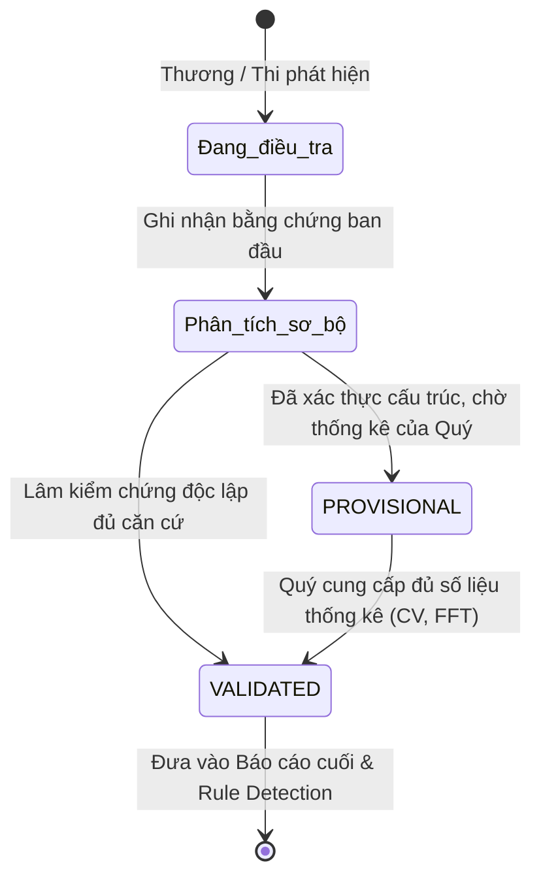

# Tiêu chuẩn Bằng chứng & Quy chuẩn Dữ liệu Điều tra (Evidence Standards)

**Đồ án:** NT140 – Malware Network Communication Analysis & Threat Detection  
**Phụ trách biên soạn:** Lâm – Threat Intelligence & Detection Validation Analyst  
**Áp dụng:** Toàn bộ thành viên nhóm (Thương, Thi, Quý, Lâm)  
**Phiên bản:** 1.0 (Quy chuẩn Tuần 1)  

---

## 1. Mục đích & Nguyên tắc Cốt lõi

Để đảm bảo tính nhất quán, khoa học và khả năng tái lập (reproducibility) của toàn bộ đồ án, mọi phân tích mạng, tái dựng hành vi và thuật toán phát hiện phải tuân thủ nghiêm ngặt các tiêu chuẩn được quy định trong tài liệu này.

> **Nguyên tắc "Chain of Custody" trong Network Forensics:**
> Mỗi nhận định về mã độc bắt buộc phải truy vết ngược được về:
> **Finding ID → Evidence ID → PCAP / Frame Number / TCP Stream → Raw Bytes / Hex Dump**.

---

## 2. Định dạng Định danh (Identifier Formats)

Nhóm thống nhất sử dụng cấu trúc mã hóa 3 chữ số có tiền tố:

| Tiền tố | Định dạng | Ví dụ | Ý nghĩa & Phạm vi áp dụng |
|---|---|---|---|
| **FND** | `FND-NNN` | `FND-001`, `FND-002` | **Finding ID:** Mã phát hiện một chuỗi hành vi hoặc hiện tượng nghi vấn cụ thể. |
| **EVD** | `EVD-NNN` | `EVD-001`, `EVD-004` | **Evidence ID:** Mã bằng chứng mạng trực tiếp (ảnh chụp packet, stream, filter cụ thể). |
| **IOC** | `IOC-NNN` | `IOC-001`, `IOC-010` | **Indicator of Compromise ID:** Chỉ số thỏa hiệp (IP, Domain, URL, Hash, Port). |
| **RULE**| `RULE-NNN`| `RULE-001`, `RULE-002`| **Detection Rule ID:** Quy tắc phát hiện được Quý cài đặt trong Zeek/Python. |

*Lưu ý:* Một Finding có thể liên kết với nhiều Evidence (ví dụ: `FND-001` gắn với `EVD-001` và `EVD-002`).

---

## 3. Tiêu chuẩn Định dạng Thời gian (Timestamp Standardization)

Thời gian là yếu tố quyết định để sắp xếp dòng thời gian tấn công (Attack Timeline) và kiểm chứng quan hệ nhân quả.

1. **Chuẩn bắt buộc:** Định dạng **ISO 8601 UTC** mở rộng đến microsecond:
   $$\text{YYYY-MM-DDTHH:MM:SS.ffffffZ}$$
   *Ví dụ chuẩn:* `2011-08-10T09:09:23.040703Z`
2. **Thời gian tương đối (Relative Time):** Bắt buộc kèm theo số giây tính từ đầu file capture (lấy từ cột `Time` của Wireshark với cấu hình *Seconds Since Beginning of Capture*):
   *Ví dụ chuẩn:* `462.564911` (giây).
3. **Cảnh báo múi giờ:** Không sử dụng giờ hiển thị cục bộ (Local Timezone của máy Windows) để ghi nhận trong báo cáo kỹ thuật nhằm tránh lệch múi giờ giữa các thành viên.

---

## 4. Phân loại 3 Cấp độ Nhận định (Epistemological Classification)

Mọi báo cáo kỹ thuật phải phân biệt rạch ròi giữa 3 cấp độ thông tin:

```
[Mức độ Nhận định]
├── 1. OBSERVED (Quan sát trực tiếp)  : Những gì thấy tận mắt trong packet / log thô.
├── 2. INFERRED (Suy luận có logic)   : Phân tích kỹ thuật dựa trên chuỗi quan sát.
└── 3. UNCONFIRMED (Chưa xác nhận)    : Giả thuyết cần thêm số liệu / telemetry khác.
```

### Tiêu chuẩn chi tiết:
* **OBSERVED:** Chỉ mô tả dữ kiện kỹ thuật thuần túy, không gán nhãn đạo đức/tính chất.
  * *Hợp lệ:* "Frame 718 gửi HTTP GET `/temp/3425.exe`, Frame 899 nhận body có byte `0x4D 0x5A`."
  * *Không hợp lệ:* "Máy nhiễm tải mã độc phá hoại."
* **INFERRED:** Rút ra kết luận có căn cứ, liên kết các sự kiện.
  * *Hợp lệ:* "Sau 45.85 ms nhận IP từ phản hồi HTTP, máy gửi TCP SYN tới đúng IP đó → Cơ chế chuyển hướng endpoint."
* **UNCONFIRMED:** Ghi rõ những giới hạn mà dữ liệu mạng không thể chứng minh.
  * *Hợp lệ:* "Chưa xác nhận file `.exe` đã được thực thi trên máy nạn nhân do không có Windows Event Logs."

---

## 5. Thang đo Mức độ Tin cậy (Confidence Levels)

Mỗi phát hiện và IOC phải được đánh giá mức độ tin cậy theo 3 mức:

| Mức độ | Định nghĩa kỹ thuật | Điều kiện đạt được |
|---|---|---|
| **Cao (High / Confirmed)** | Bằng chứng mạng rõ ràng, không thể hiểu khác, được kiểm chứng chéo với ground truth CTU-13. | Thấy rõ payload nhị phân, phản hồi thành công, mã băm hoặc tài liệu dataset xác nhận. |
| **Trung bình (Medium / Suspicious)** | Có hành vi bất thường rõ rệt nhưng còn có thể giải thích bằng nguyên nhân khác (cần kiểm chứng thống kê). | Thấy kết nối lặp hoặc port lạ nhưng chưa giải mã được nội dung bên trong. |
| **Thấp (Low / Contextual)** | Dữ liệu chỉ mang tính bối cảnh, phụ trợ. | User-Agent, thông tin DNS phụ, hoặc kết nối nền chưa rõ ràng. |

---

## 6. Vòng đời Trạng thái Kiểm chứng (Validation Lifecycle)

Mỗi Finding trong suốt đồ án sẽ trải qua các trạng thái sau dưới sự kiểm duyệt của **Lâm (Validation Analyst)**:



* **Đang điều tra (Under Investigation):** Thành viên mới ghi nhận dấu hiệu.
* **Provisional (Tạm thời có căn cứ):** Bằng chứng cấu trúc đã rõ nhưng cần phép đo thống kê (ví dụ: cần tính độ biến thiên chu kỳ CV để khẳng định Beaconing).
* **Validated (Đã kiểm chứng):** Đạt chuẩn kiểm chứng độc lập 3 chiều của Lâm.
