# Scenario 01 – Phân tích bằng chứng giao tiếp mạng của Neris
**Đồ án:** NT140 – Malware Network Communication Analysis & Threat Detection  

**Đảm nhận:** Ngoc Thi – Malware Communication Analyst  

**Bộ dữ liệu:** CTU-13, Scenario 1 – Neris  

**File PCAP:** `botnet-capture-20110810-neris.pcap`  

**Công cụ:** Wireshark  

**Trạng thái:** Đang phân tích

## 1. Thông tin bộ dữ liệu
| Thuộc tính | Giá trị |
|---|---|
| Scenario | CTU-13 Scenario 1 – Neris |
| Dung lượng PCAP | Khoảng 58 MB |
| Tổng số packet | 323.154 |
| Ngày capture | 10/08/2011 |
| Thời gian capture | 04:47:48 |
| Định dạng đóng gói | Ethernet |
| Máy nhiễm botnet | `147.32.84.165` |
| SHA-256 | `b89cd5931f62d87ceff266568c97c6e36e56dd0330813cacadbc14a6c5576a36` |

IP máy nhiễm `147.32.84.165` được xác định dựa trên metadata của CTU-13 Scenario 1.

Thời gian hiển thị trong Wireshark có thể phụ thuộc vào múi giờ của máy phân tích. Khi xây dựng attack timeline, cần chuẩn hóa timestamp để tránh sai lệch.

### 1.1. Thống kê giao thức
Sử dụng `Statistics → Protocol Hierarchy` trong Wireshark để khảo sát các giao thức xuất hiện trong PCAP.

| Giao thức | Số packet | Tỷ lệ |
|---|---:|---:|
| TCP | 235.622 | 72,9% |
| UDP | 85.865 | 26,6% |
| DNS | 84.574 | 26,2% |
| HTTP | 2.676 | 0,8% |
| IRC | 61 | Dưới 0,1% |
| TLS | 1.567 | 0,5% |

TCP chiếm phần lớn lưu lượng mạng, trong khi DNS cũng xuất hiện với tỷ lệ đáng kể. Ngoài ra, PCAP có các packet được Wireshark nhận diện là HTTP, IRC và TLS.

Các thống kê này chỉ phản ánh thành phần giao thức của PCAP, chưa đủ để xác định hành vi độc hại.

### 1.2. Ảnh khảo sát tổng quan

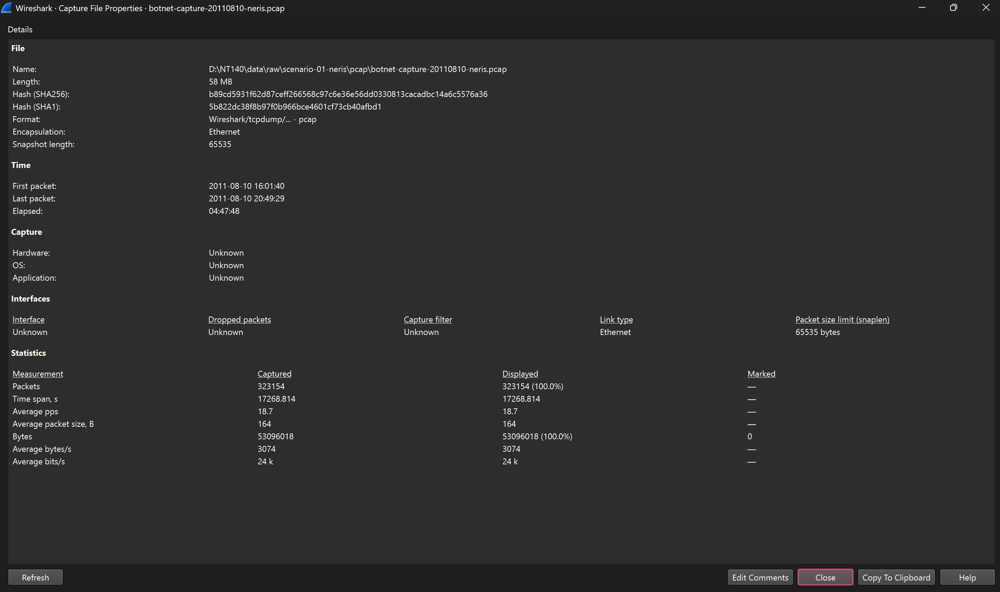

*Hình 1. Capture File Properties: thông tin bản PCAP, thời lượng và SHA-256.*

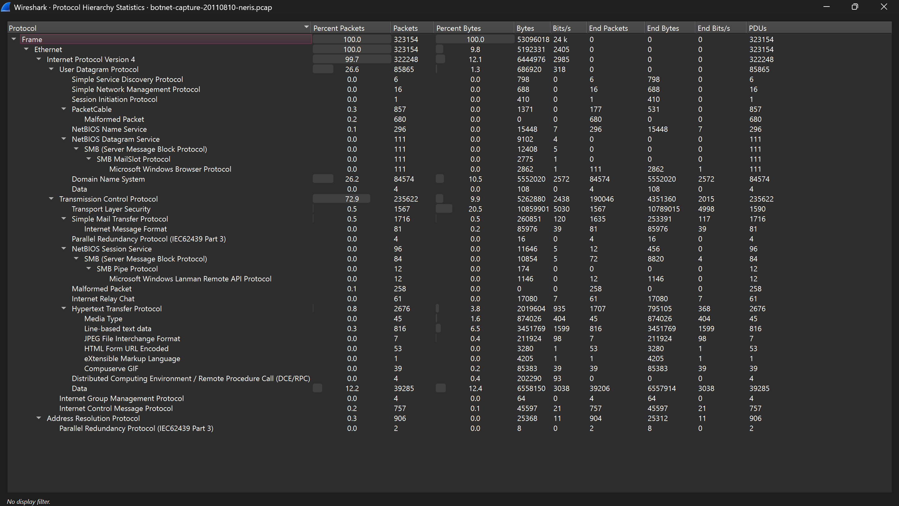

*Hình 2. Protocol Hierarchy: phân bố các giao thức được Wireshark nhận diện.*

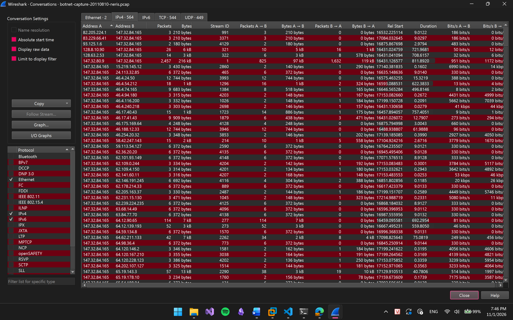

*Hình 3. IPv4 Conversations: tổng quan các cặp IP, chưa đủ cơ sở phân loại độc hại.*

---

## 2. FND-001 – HTTP response cung cấp endpoint và kết nối TCP tiếp theo
**Finding ID:** FND-001  

**Evidence ID:** EVD-001, EVD-002  

**Nhóm hành vi:** Nghi vấn C2 Communication  

**Trạng thái:** Đang điều tra

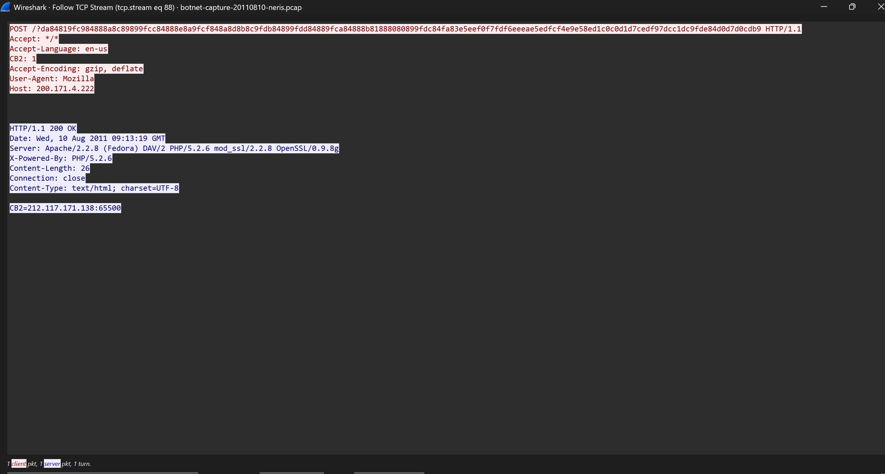

### 2.1. Quan sát (Observation)
Trong quá trình phân tích TCP stream 88, phát hiện một phiên giao tiếp giữa máy nhiễm `147.32.84.165` và địa chỉ bên ngoài `200.171.4.222`.

HTTP request sử dụng phương thức POST, có header tùy chỉnh:

`CB2: 1`

Máy chủ phản hồi HTTP `200 OK`, trong phần nội dung có chuỗi:

`CB2=212.117.171.138:65500`

Thông tin packet:

| Thuộc tính | Giá trị |
|---|---|
| Frame HTTP response | 2297 |
| TCP stream | 88 |
| IP nguồn | `200.171.4.222` |
| Port nguồn | 6667 |
| IP đích | `147.32.84.165` |
| Port đích | 1288 |
| HTTP status | 200 OK |
| Nội dung response | `CB2=212.117.171.138:65500` |

Sau khi nhận HTTP response, máy nhiễm tiếp tục khởi tạo một kết nối TCP đến chính endpoint được cung cấp.

Sử dụng Wireshark Display Filter:

`ip.addr == 212.117.171.138 && tcp.port == 65500`

Kết quả quan sát:

| Frame | Thời gian tương đối (giây) | Sự kiện |
|---|---:|---|
| 2297 | 462,564911 | Nhận HTTP response chứa endpoint |
| 2303 | 462,610762 | Máy nhiễm gửi TCP SYN đến `212.117.171.138:65500` |
| 2305 | 462,633239 | Server phản hồi SYN, ACK |
| 2306 | 462,633544 | Máy nhiễm gửi ACK, hoàn thành TCP three-way handshake |
| 3204 | 548,015184 | Server gửi dữ liệu TCP về máy nhiễm |

Khoảng cách giữa HTTP response tại frame 2297 và TCP SYN tại frame 2303 là khoảng **45,85 ms**.

Như vậy, PCAP cho thấy máy nhiễm nhận một địa chỉ IP và port từ HTTP response, sau đó thiết lập kết nối TCP đến chính endpoint đó.

### 2.1.1. Ảnh bằng chứng EVD-001 – HTTP response chứa endpoint

*Hình 4. TCP stream 88: HTTP POST với header `CB2: 1` và response chứa `CB2=212.117.171.138:65500`.*

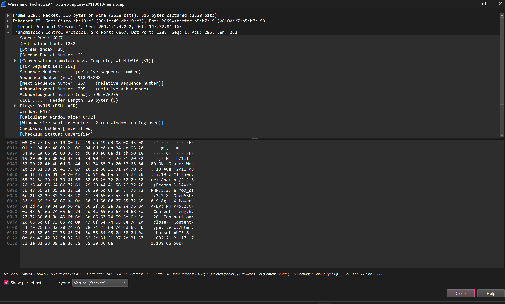

*Hình 5. Frame 2297: gói HTTP response từ `200.171.4.222:6667` về `147.32.84.165:1288`.*

### 2.1.2. Ảnh bằng chứng EVD-002 – Kết nối TCP tiếp theo

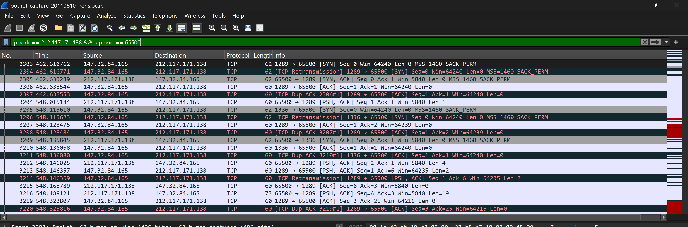

*Hình 6. Bộ lọc `ip.addr == 212.117.171.138 && tcp.port == 65500`: quan sát SYN, SYN/ACK và ACK.*

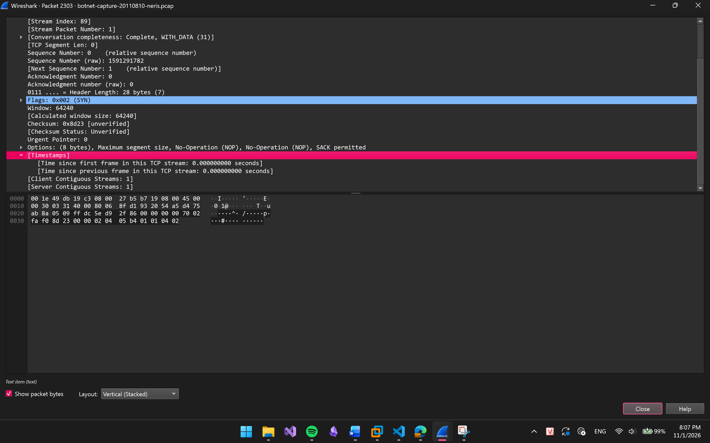

*Hình 7. Frame 2303: SYN khởi tạo kết nối, `tcp.stream == 89`. Đây là ảnh chi tiết SYN, chưa phải ảnh Follow TCP Stream 89.*

### 2.2. Nhận định (Interpretation)
Chuỗi sự kiện trên gợi ý một cơ chế cung cấp thông tin endpoint để thiết lập phiên liên lạc tiếp theo.

Điều này phù hợp với giả thuyết về hành vi C2, trong đó một máy chủ có thể cung cấp thông tin của một máy chủ liên lạc khác.

Tuy nhiên, hiện tại mới xác nhận được việc nhận IP endpoint và thiết lập kết nối TCP. Chưa đủ bằng chứng để kết luận vai trò cụ thể của endpoint `212.117.171.138:65500` trong hệ thống C2.

### 2.3. Mức độ tin cậy và giới hạn
- **Cao:** HTTP response chứa IP endpoint và máy nhiễm thực sự kết nối đến IP đó.

- **Trung bình:** Hai sự kiện có liên hệ về mặt hành vi do diễn ra liên tiếp và sử dụng đúng endpoint được cung cấp.

- **Chưa xác nhận:** Endpoint mới có thực hiện chức năng C2 hay truyền lệnh điều khiển malware hay không.

### 2.4. Hướng điều tra tiếp theo
- Phân tích TCP stream chứa frame 2303 để xem dữ liệu trao đổi.

- Kiểm tra số lượng và thời lượng kết nối đến `212.117.171.138:65500`.

- Xác định có những kết nối lặp lại đến endpoint này hay không.

- Đối chiếu với ground truth của CTU-13.

- Nhờ Thương kiểm chứng lại packet evidence và Lâm xác minh nhận định.

---

## 3. FND-002 – HTTP GET có tham số truy vấn dài và xuất hiện lặp lại
**Finding ID:** FND-002  

**Evidence ID:** EVD-003  

**Nhóm hành vi:** HTTP Communication / Nghi vấn giao tiếp tự động  

**Trạng thái:** Phân tích sơ bộ

### 3.1. Quan sát (Observation)
Trong PCAP, máy nhiễm `147.32.84.165` gửi các HTTP GET request đến những máy chủ bên ngoài.

Một phiên tiêu biểu:

| Thuộc tính | Giá trị |
|---|---|
| Request frame | 4491 |
| Response frame | 4495 |
| TCP stream | 208 |
| IP nguồn | `147.32.84.165` |
| Port nguồn | 1391 |
| IP đích | `60.190.223.75` |
| Port đích | 888 |
| HTTP Host | `w.nucleardiscover.com:888` |
| HTTP method | GET |
| URI path | `/sn.php` |
| HTTP status | 200 OK |

HTTP GET chứa tham số `c` có giá trị là một chuỗi ký tự dài, chủ yếu có dạng hexadecimal.

Request cũng chứa User-Agent:

`Mozilla/4.0 (compatible; MSIE 6.0.2900.2180; Windows NT 5.1.2600)`

Khi sử dụng bộ lọc:

`http.request && ip.addr == 147.32.84.165`

quan sát được nhiều HTTP request khác có URI `/sn.php`.

Các request này xuất hiện tại nhiều thời điểm và có thể hướng đến những destination khác nhau.

### 3.1.1. Ảnh bằng chứng EVD-003 – HTTP GET với tham số dài

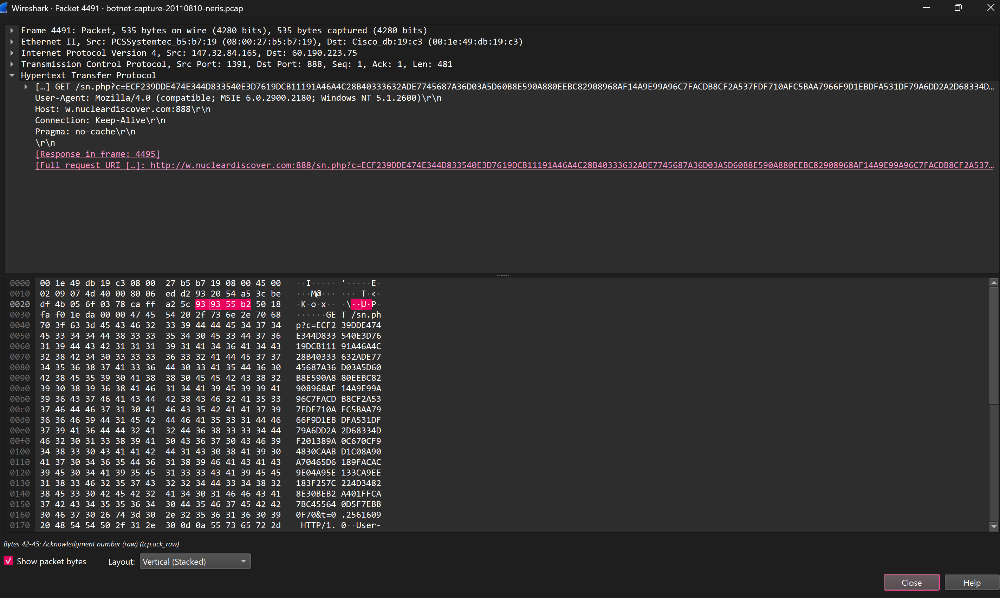

*Hình 8. Frame 4491: request `GET /sn.php` từ máy nhiễm tới `60.190.223.75:888`, có tham số `c` dài.*

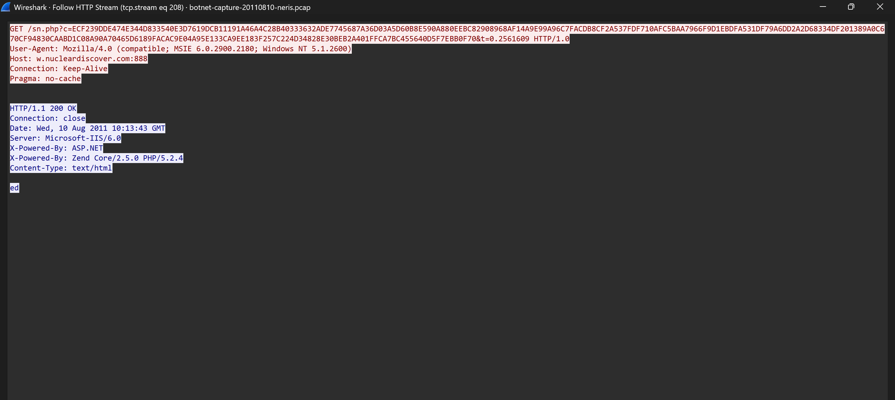

*Hình 9. TCP stream 208: nội dung request và response `HTTP/1.1 200 OK`.*

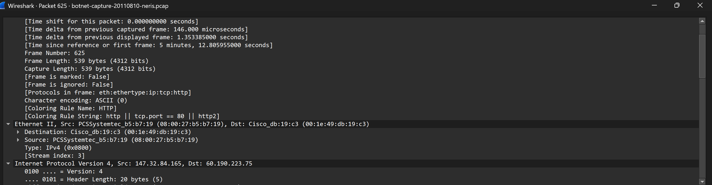

*Hình 10. Frame 625: một request HTTP tới cùng IP, dùng làm dữ liệu bổ trợ để khảo sát nhiều request; không tự suy ra periodicity.*

### 3.2. Nhận định (Interpretation)
Việc xuất hiện nhiều HTTP request có cấu trúc tương tự và tham số truy vấn dài gợi ý khả năng đây là hoạt động giao tiếp được tự động hóa.

Tuy nhiên, chưa xác định được nội dung thực tế của tham số `c`, cũng chưa chứng minh được tham số này chứa dữ liệu bị đánh cắp hoặc lệnh điều khiển.

Để kiểm tra giả thuyết beaconing, cần phân nhóm những request có cùng đặc điểm giao tiếp, sau đó phân tích khoảng cách thời gian giữa các lần kết nối.

### 3.3. Mức độ tin cậy và giới hạn
- **Cao:** Đã quan sát HTTP GET chứa tham số truy vấn dài.

- **Trung bình:** Có nhiều HTTP request mang cấu trúc tương tự.

- **Chưa xác nhận:** Hoạt động beaconing định kỳ, C2 hoặc exfiltration.

### 3.4. Hướng điều tra tiếp theo
- Thống kê các request đến cùng destination và URI.

- Trích xuất timestamp của từng request.

- Tính inter-arrival time, mean, standard deviation và coefficient of variation (CV).

- Đối chiếu tính định kỳ với những hoạt động mạng hợp lệ.

- Chuyển danh sách request nghi vấn cho Quý để kiểm chứng bằng thống kê.

---

## 4. FND-003 – HTTP response chứa nội dung tương ứng với file thực thi Windows
**Finding ID:** FND-003  

**Evidence ID:** EVD-004  

**Nhóm hành vi:** Nghi vấn Malware Download  

**Trạng thái:** Đang điều tra

### 4.1. Quan sát (Observation)
Trong quá trình phân tích các HTTP request từ máy nhiễm, phát hiện request truy cập một tài nguyên có phần mở rộng `.exe`.

| Thuộc tính | Giá trị |
|---|---|
| Request frame | 718 |
| TCP stream | 13 |
| IP nguồn | `147.32.84.165` |
| IP đích | `195.88.191.59` |
| HTTP Host | `nomcom.com` |
| Request URI | `/temp/3425.exe?t=0.3419458` |
| HTTP method | GET |
| HTTP response | 200 OK |
| Server | nginx |
| Content-Type | `application/octet-stream` |
| Content-Length | 28.160 bytes |

Khi sử dụng chức năng Follow HTTP Stream, quan sát được phần nội dung phản hồi bắt đầu bằng chữ ký:

`MZ`

Ngoài ra, phần dữ liệu còn chứa chuỗi:

`This program cannot be run in DOS mode.`

Đây là những đặc điểm thường xuất hiện trong cấu trúc file Portable Executable (PE) của Windows.

Ngoài request trên, còn quan sát được một số request đến những tài nguyên khác có phần mở rộng `.exe`:

| Frame | Destination | URI |
|---|---|---|
| 1744 | `195.88.191.59` | `/bl/client.exe` |
| 2024 | `195.88.191.59` | `/sv/fjuivgfhurew.exe` |

Hiện chưa phân tích đầy đủ response của hai request này.

### 4.1.1. Ảnh bằng chứng EVD-004 – Response chứa dữ liệu kiểu PE

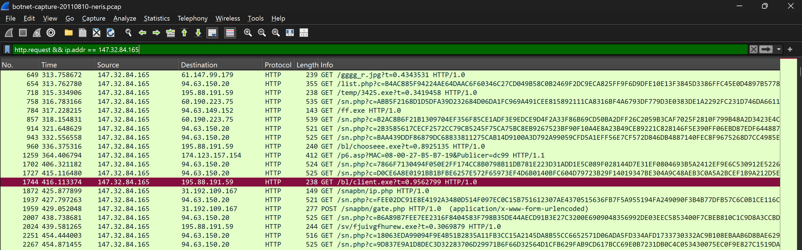

*Hình 11. Danh sách HTTP requests của `147.32.84.165`, có các URI đuôi `.exe` tại frame 718, 1744 và 2024.*

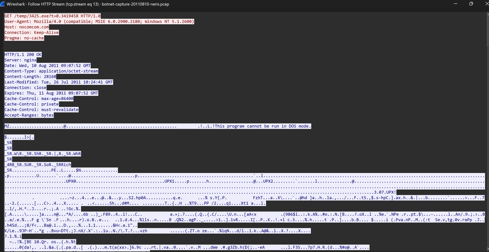

*Hình 12. TCP stream 13: response `200 OK`, `Content-Length: 28160`, dữ liệu có tiền tố `MZ`.*

### 4.2. Nhận định (Interpretation)
HTTP response của request `/temp/3425.exe` chứa nội dung có đặc điểm phù hợp với file thực thi PE của Windows.

Điều này cho thấy có hoạt động truyền dữ liệu mang nội dung giống file thực thi từ máy chủ bên ngoài đến máy nhiễm.

Đây là dấu hiệu phù hợp với hướng điều tra malware download, nhưng chỉ từ network evidence chưa thể xác nhận file đã được lưu trên ổ đĩa, được thực thi hoặc thực sự là mã độc.

### 4.3. Mức độ tin cậy và giới hạn
- **Cao:** HTTP request đến tài nguyên `.exe` và server trả về HTTP 200 OK.

- **Cao:** Nội dung response có chữ ký `MZ` và chuỗi đặc trưng của PE.

- **Chưa xác nhận:** Toàn bộ dữ liệu có được capture đầy đủ hay không.

- **Chưa xác nhận:** File được thực thi hoặc có hành vi độc hại.

### 4.4. Hướng điều tra tiếp theo
- Kiểm tra tính đầy đủ của HTTP response, đối chiếu với Content-Length.

- Phân tích response metadata của những request `.exe` khác.

- Kiểm tra các kết nối mạng xuất hiện sau thời điểm truyền file.

- Đối chiếu với ground truth và bối cảnh của scenario.

- Không thực thi file nghi vấn trong môi trường máy thật.

---

## 5. Tổng hợp bằng chứng
| Finding | Evidence | Hành vi quan sát | Trạng thái |
|---|---|---|---|
| FND-001 | EVD-001, EVD-002 | HTTP response cung cấp endpoint, sau đó máy nhiễm thiết lập kết nối TCP tới endpoint | Đang điều tra |
| FND-002 | EVD-003 | HTTP GET có tham số dài và nhiều request tương tự | Phân tích sơ bộ |
| FND-003 | EVD-004 | HTTP response chứa nội dung phù hợp với file PE | Đang điều tra |

Ba finding hiện tại mới phản ánh những hành vi quan sát được trong PCAP và các giả thuyết cần kiểm chứng. Chưa finding nào được xác nhận hoàn toàn về vai trò độc hại dựa trên kết quả đánh giá độc lập.

## 6. Kết luận
Qua phân tích PCAP của CTU-13 Scenario 1 – Neris bằng Wireshark, đã ghi nhận được ba nhóm dấu hiệu đáng chú ý:

- **Giao tiếp liên quan đến endpoint:** Máy nhiễm nhận HTTP response chứa thông tin IP và port, sau đó thiết lập kết nối TCP đến chính endpoint được cung cấp.

- **Giao tiếp HTTP có cấu trúc lặp:** Xuất hiện các HTTP GET request có tham số dài và cấu trúc tương tự, cần kiểm chứng thêm tính định kỳ.

- **Truyền dữ liệu dạng file thực thi:** Phát hiện HTTP response chứa nội dung có đặc điểm phù hợp với file PE của Windows.

Những bằng chứng này tạo cơ sở để tiếp tục tái dựng hành vi malware, kiểm tra giả thuyết C2 communication và malware download. Tuy nhiên, các kết luận về vai trò C2, beaconing và tính độc hại của file vẫn cần được đối chiếu với ground truth và các bằng chứng bổ sung.
